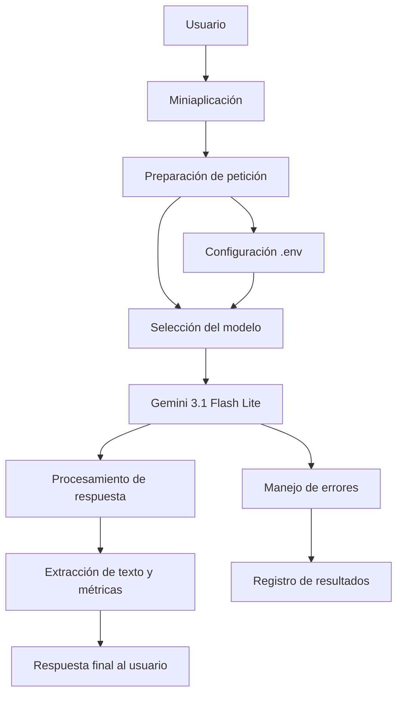

======================================================================
Evaluando modelo: gemini-3.6-flash
======================================================================

---Intento 1 de 4 (gemini-3.6-flash):---
Tokens de entrada: 138
Tokens de salida: 113
Tokens de razonamiento: 880
Tokens de entrada: 138
Tokens de salida: 113
Latencia: 7.5026 segundos
Costo: $0.0029928000
Respuesta: ¡Buen trabajo en la estructura inicial de tu función! Para mejorarla, te invito a reflexionar sobre lo siguiente:

1. ¿Qué sucedería en la línea del `return` si intentas calcular el promedio de una lista vacía `[]` o si esta contiene texto?
2. ¿Conoces alguna función nativa de Python que te permita sumar todos los elementos de una lista sin usar un ciclo `for`?
3. Te sugiero probar esos casos en tu intérprete para descubrir cómo hacer tu código más robusto y eficiente.

---Intento 2 de 4 (gemini-3.6-flash):---
Tokens de entrada: 138
Tokens de salida: 73
Tokens de razonamiento: 731
Tokens de entrada: 138
Tokens de salida: 73
Latencia: 7.0080 segundos
Costo: $0.0024258000
Respuesta: ¡Buen trabajo con la estructura base de tu función! 

¿Qué crees que ocurriría al ejecutar la última línea si la lista estuviera vacía (`[]`) o si contuviera texto?
Además, ¿conoces alguna función integrada de Python que te permita sumar todos los elementos de una lista directamente sin usar el bucle `for`?

---Intento 3 de 4 (gemini-3.6-flash):---
Error al evaluar el modelo gemini-3.6-flash: Error en la petición: 429 - {
  "error": {
    "code": 429,
    "message": "You exceeded your current quota, please check your plan and billing details. For more information on this error, head to: https://aistudio.google.com/docs/rate-limits. To monitor your current usage, head to: https://ai.dev/rate-limit. \n* Quota exceeded for metric: generativelanguage.googleapis.com/generate_content_free_tier_requests, limit: 20, model: gemini-3.6-flash, description: Generate content requests per day limit exceeded on Free Tier. See https://aistudio.google.com/docs/rate-limits.\nPlease retry in 3h55m55.163283452s.",
    "status": "RESOURCE_EXHAUSTED",
    "details": [
      {
        "@type": "type.googleapis.com/google.rpc.Help",
        "links": [
          {
            "description": "Learn more about Gemini API quotas",
            "url": "https://aistudio.google.com/docs/rate-limits"
          }
        ]
      },
      {
        "@type": "type.googleapis.com/google.rpc.QuotaFailure",
        "violations": [
          {
            "description": "Generate content requests per day limit exceeded on Free Tier. See https://aistudio.google.com/docs/rate-limits.",
            "quotaMetric": "generativelanguage.googleapis.com/generate_content_free_tier_requests",
            "quotaId": "GenerateRequestsPerDayPerProjectPerModel-FreeTier",
            "quotaDimensions": {
              "location": "global",
              "model": "gemini-3.6-flash"
            },
            "quotaValue": "20"
          }
        ]
      },
      {
        "@type": "type.googleapis.com/google.rpc.RetryInfo",
        "retryDelay": "14155s"
      }
    ]
  }
}

======================================================================
Evaluando modelo: gemini-3.1-flash-lite
======================================================================

---Intento 1 de 4 (gemini-3.1-flash-lite):---
Tokens de entrada: 138
Tokens de salida: 61
Tokens de razonamiento: 0
Tokens de entrada: 138
Tokens de salida: 61
Latencia: 2.4630 segundos
Costo: $0.0003322500
Respuesta: ¡Hola! Tu lógica es correcta, pero considera qué sucede si la lista está vacía al intentar calcular su longitud. ¿Qué valor arrojaría `len(lista)` en ese caso y cómo afectaría a la división? ¿Cómo podrías validar el contenido de la lista antes de procesarlo?

---Intento 2 de 4 (gemini-3.1-flash-lite):---
Tokens de entrada: 138
Tokens de salida: 60
Tokens de razonamiento: 0
Tokens de entrada: 138
Tokens de salida: 60
Latencia: 1.5978 segundos
Costo: $0.0003285000
Respuesta: ¡Hola! Tu lógica para sumar es correcta, pero ¿qué sucede si la lista está vacía al intentar ejecutar `len(lista)` en la división? Considera qué valor debería devolver la función en ese caso y si existen funciones nativas de Python que simplifiquen tu ciclo `for`.

---Intento 3 de 4 (gemini-3.1-flash-lite):---
Tokens de entrada: 138
Tokens de salida: 57
Tokens de razonamiento: 0
Tokens de entrada: 138
Tokens de salida: 57
Latencia: 2.2297 segundos
Costo: $0.0003172500
Respuesta: ¡Hola! Tu lógica es correcta, pero considera qué sucede si la lista está vacía al momento de calcular `len(lista)`. ¿Qué operación matemática intenta realizar el programa y qué error arroja? ¿Cómo podrías validar el contenido de la lista antes de procesarla?

---Intento 4 de 4 (gemini-3.1-flash-lite):---
Tokens de entrada: 138
Tokens de salida: 58
Tokens de razonamiento: 0
Tokens de entrada: 138
Tokens de salida: 58
Latencia: 2.3823 segundos
Costo: $0.0003210000
Respuesta: ¡Hola! Tu lógica es correcta, pero considera qué sucede si la `lista` está vacía al intentar calcular `len(lista)`. ¿Qué ocurriría si intentas realizar una división por cero? Te sugiero investigar cómo validar el contenido de la lista antes de procesarla.

======================================================================

Resumen acumulado para gemini-3.1-flash-lite:
Latencia promedio: 2.17 segundos
Costo acumulado: (4 peticiones): $0.001299 USD
======================================================================
Evaluando modelo: gemini-3.8-flash
======================================================================

---Intento 1 de 4 (gemini-3.8-flash):---
Error al evaluar el modelo gemini-3.8-flash: La petición ha superado el tiempo de espera.

# Decisión de arquitectura: elección de modelo

## Modelo elegido

**Gemini 3.1 Flash Lite**, para la funcionalidad principal de generación de respuestas de la miniaplicación.

## Diagrama de arquitectura

El flujo comienza con la solicitud del usuario, que es preparada y enviada al modelo seleccionado mediante la API de Gemini. Posteriormente, se procesa la respuesta, se extrae el contenido generado y se registran las métricas de ejecución, como tokens utilizados, latencia y costo. También se contempla el manejo de errores para controlar situaciones como límites de cuota y tiempos de espera.

## Comparación de candidatos

| Criterio | Gemini 3.6 Flash | Gemini 3.1 Flash Lite | Gemini 3.8 Flash |
|---|---|---|---|
| Costo observado | $0.0054186 USD (2 respuestas) | $0.001299 USD (4 respuestas) | No disponible |
| Latencia promedio | 7.26 segundos (2 respuestas) | 2.17 segundos | Timeout |
| Estabilidad | Limitada por cuota | 4 de 4 respuestas exitosas | No determinada |
| Calidad de respuesta | Buena: preguntas orientadoras y explicaciones más elaboradas | Buena: respuestas breves y orientadas a la enseñanza | No evaluada |
| Disponibilidad | Error 429 por límite de cuota | Ejecución exitosa en todas las pruebas | Tiempo de espera superado |
| Resultado | Alternativa descartada | Modelo seleccionado | Sin evidencia suficiente |

**Nota:** Los costos de Gemini 3.6 Flash corresponden únicamente a las dos respuestas exitosas. No se dispone de información suficiente para determinar su costo promedio definitivo ni para evaluar la calidad de Gemini 3.8 Flash.

## Justificación

Para esta miniaplicación, el criterio más importante fue encontrar un modelo que ofreciera respuestas suficientemente buenas sin generar costos elevados ni tiempos de espera excesivos.

Gemini 3.1 Flash Lite obtuvo los mejores resultados generales durante las pruebas realizadas. Completó correctamente las cuatro solicitudes, alcanzando una latencia promedio de 2.17 segundos y un costo acumulado de apenas $0.001299 USD.

Además, sus respuestas mantuvieron un enfoque educativo, proporcionando preguntas orientadoras y sugerencias para que el usuario pudiera comprender y mejorar su código.

En comparación, Gemini 3.6 Flash produjo respuestas más elaboradas, pero presentó una latencia considerablemente mayor y un error 429 debido al límite de solicitudes del nivel gratuito. Por su parte, Gemini 3.8 Flash superó el tiempo de espera establecido, por lo que no fue posible completar su evaluación.

Considerando el propósito de la aplicación, el volumen de solicitudes esperado y la necesidad de mantener costos reducidos, Gemini 3.1 Flash Lite representa la alternativa más conveniente con los datos disponibles.

## Alternativa descartada y por qué

Se descartó **Gemini 3.6 Flash** como modelo principal porque, aunque proporcionó respuestas más desarrolladas, su costo observado fue superior y su latencia promedio alcanzó los 7.26 segundos.

Además, durante el tercer intento presentó un error HTTP 429 por superar la cuota diaria de solicitudes del nivel gratuito. Esto representa una limitación importante para una aplicación que necesita mantener disponibilidad y responder de manera consistente.

También se evaluó Gemini 3.8 Flash, pero su ejecución terminó por superar el tiempo de espera, sin proporcionar información suficiente para realizar una comparación confiable.

Por estas razones, se seleccionó Gemini 3.1 Flash Lite, ya que ofrece una respuesta suficientemente adecuada para las necesidades de la aplicación, con menor costo, menor latencia y mayor estabilidad observada durante las pruebas.